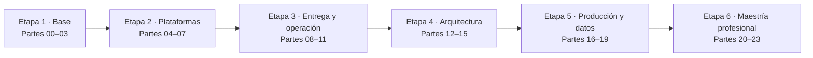
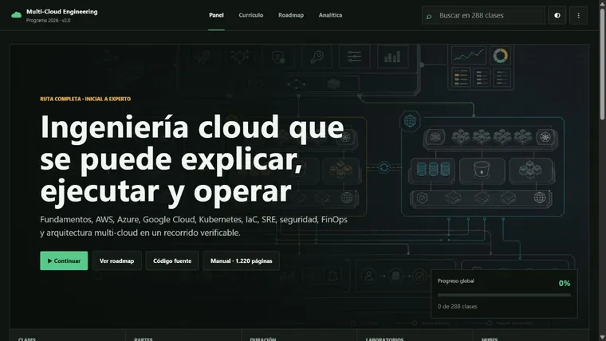
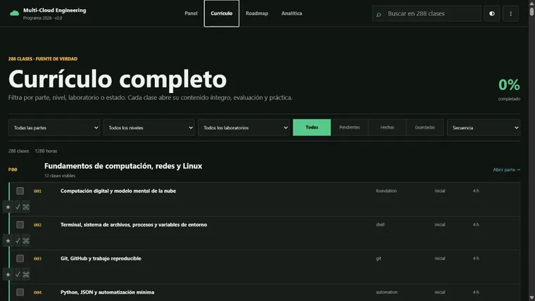
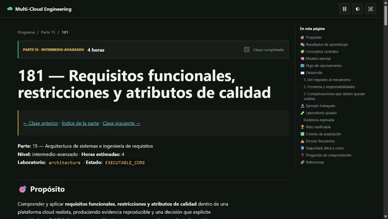

<div align="center">

# ☁️ Multi-Cloud Engineering Program

## **288 clases · 24 partes · 1.288 horas · de cero a arquitectura cloud experta**

**El programa de ingeniería multi-cloud más completo en español — desde computación, redes y Linux hasta Kubernetes, IaC, SRE, FinOps, arquitectura distribuida y operación productiva en AWS, Azure y Google Cloud.**

[](https://github.com/vladimiracunadev-create/multi-cloud-engineering-program/actions/workflows/ci.yml)
[](https://vladimiracunadev-create.github.io/multi-cloud-engineering-program/)
[](https://github.com/vladimiracunadev-create/multi-cloud-engineering-program/actions/workflows/security.yml)

[](CHANGELOG.md)
[](classes/README.md)
[](site/downloads/multi-cloud-engineering-manual-v2.0.pdf)
<!-- sources:badge:begin -->
[](sources/bibliography.json)
<!-- sources:badge:end -->

[](https://github.com/vladimiracunadev-create/multi-cloud-engineering-program/releases/latest)
[](LICENSE)

[🌐 Portal](https://vladimiracunadev-create.github.io/multi-cloud-engineering-program/) ·
[📚 Índice de las 288 clases](classes/README.md) ·
[📕 Manual completo (PDF)](site/downloads/multi-cloud-engineering-manual-v2.0.pdf) ·
[📱 App Android (APK)](https://github.com/vladimiracunadev-create/multi-cloud-engineering-program/releases/latest) ·
[📅 Syllabus](docs/SYLLABUS.md) ·
[🗺️ Roadmap](ROADMAP.md) ·
[🤝 Contribuir](CONTRIBUTING.md) ·
[🔐 Seguridad](SECURITY.md)

**Cobertura por proveedor:**
[AWS](classes/part-02-aws-core-platform/README.md) ·
[Azure](classes/part-03-azure-core-platform/README.md) ·
[Google Cloud](classes/part-04-gcp-core-platform/README.md) ·
[Kubernetes](classes/part-06-kubernetes-managed-platforms/README.md) ·
[Terraform](classes/part-07-infrastructure-as-code-configuration/README.md)

</div>

---

> [!WARNING]
> **Costo y seguridad.** Los laboratorios base **no crean recursos cloud** y no requieren tarjeta ni credenciales. Para practicar en cuentas reales usa un sandbox autorizado con presupuesto, alertas, credenciales temporales, etiquetas y destrucción verificada. Nunca ejecutes un despliegue que no puedas explicar, observar y retirar.

## 🎯 Qué es esto

Un currículo **secuencial, basado en libros y orientado a evidencia**: 288 clases numeradas (001→288) agrupadas en 24 partes, desde principiante absoluto hasta decisiones de arquitectura y operación en producción. Cada clase es una carpeta con un `README.md` completo que incluye:

- 🎯 **Propósito** y **resultados de aprendizaje verificables**.
- 🧩 **Conceptos centrales** y **modelo mental** del mecanismo.
- 🗺️ **Flujo de razonamiento** en diagrama Mermaid.
- 📖 **Desarrollo guiado** con fronteras, responsabilidades y compensaciones visibles.
- 🔬 **Ejemplo trabajado** con números concretos.
- 🧪 **Laboratorio ejecutable** (`lab.py`) con evidencia JSON reproducible.
- 🏆 **Reto verificable** con **criterio de aceptación** explícito.
- ⚠️ **Errores frecuentes** (síntoma → causa → corrección).
- 🛡️ **Seguridad, ética y costo** de lo que se acaba de construir.
- ❓ **Preguntas de comprobación** y 🔗 **referencias** a la literatura del área.

## ✅ Estado verificable

| Superficie | Cobertura |
|---|---|
| 📚 Currículo | 288/288 clases; numeración continua 001–288 en 24 partes |
| 🏆 Evaluación | 288 rúbricas de clase + criterios transversales + defensa final |
| 🧪 Práctica | 288 entrypoints ejecutables, evidencia JSON, fallos controlados y cost gates |
| 📕 Manual | 2.884 páginas generadas desde 607 archivos fuente versionados |
| 🖥️ Portal | PWA instalable, buscador, filtros, rutas, progreso local y modo offline |
| 📱 Android | APK firmada de 4,0 MiB con las 288 clases dentro; funciona sin conexión |
| 🏗️ Arquitectura | Requisitos, ADR, C4, sistemas distribuidos, integración, resiliencia y DR |
| 🔧 Calidad | CI multi-OS/Python, validadores, pruebas, CodeQL, Bandit, pip-audit y Gitleaks |
| ☁️ Cuentas cloud | Opcionales; los recorridos locales no requieren credenciales ni generan costos |

## 🗺️ El recorrido en 6 etapas



| Etapa | Partes | Competencia que construye |
|---|---:|---|
| 1️⃣ Base de ingeniería | 00–03 | Computación, redes, Linux, estrategia cloud, AWS y Azure |
| 2️⃣ Plataformas y automatización | 04–07 | Google Cloud, contenedores, Kubernetes e IaC |
| 3️⃣ Entrega y operación | 08–11 | CI/CD, platform engineering, datos, SRE, seguridad y FinOps |
| 4️⃣ Arquitectura de sistemas | 12–15 | Distribuidos, multi-cloud, requisitos, C4, ADR y trade-offs |
| 5️⃣ Producción multi-proveedor | 16–19 | Redes avanzadas y arquitecturas productivas en AWS, Azure y GCP |
| 6️⃣ Maestría profesional | 20–23 | Datos e IA, incidentes, especializaciones y capstones por industria |

## 🗂️ Las 24 partes

Cada parte tiene su **propio README** con narrativa, resultados de aprendizaje y enlaces a sus 12 clases.

| # | Parte | Clases | Resultado principal | README |
|---:|---|---:|---|---|
| 00 | Fundamentos de computación, redes y Linux | 001–012 | Servicio local reproducible | [📘 leer](classes/part-00-foundations-computing-networking-linux/README.md) |
| 01 | Principios, estrategia y adopción cloud | 013–024 | ADR de migración | [📘 leer](classes/part-01-cloud-principles-strategy-adoption/README.md) |
| 02 | AWS: plataforma esencial | 025–036 | Aplicación de tres capas en AWS | [📘 leer](classes/part-02-aws-core-platform/README.md) |
| 03 | Azure: plataforma esencial | 037–048 | Aplicación de tres capas en Azure | [📘 leer](classes/part-03-azure-core-platform/README.md) |
| 04 | Google Cloud: plataforma esencial | 049–060 | Aplicación de tres capas en GCP | [📘 leer](classes/part-04-gcp-core-platform/README.md) |
| 05 | Contenedores, Docker y OCI | 061–072 | Stack endurecido y observable | [📘 leer](classes/part-05-containers-docker-oci/README.md) |
| 06 | Kubernetes y plataformas administradas | 073–084 | Plataforma portable EKS/AKS/GKE | [📘 leer](classes/part-06-kubernetes-managed-platforms/README.md) |
| 07 | Infraestructura como código | 085–096 | Infraestructura multiambiente | [📘 leer](classes/part-07-infrastructure-as-code-configuration/README.md) |
| 08 | Entrega continua y platform engineering | 097–108 | Fábrica de software multi-cloud | [📘 leer](classes/part-08-continuous-delivery-platform-engineering/README.md) |
| 09 | Datos, mensajería, serverless e integración | 109–120 | Pipeline orientado a eventos | [📘 leer](classes/part-09-data-messaging-serverless-integration/README.md) |
| 10 | Observabilidad, SRE y confiabilidad | 121–132 | Operación por SLO de CloudShop | [📘 leer](classes/part-10-observability-sre-reliability/README.md) |
| 11 | Seguridad, gobierno, cumplimiento y FinOps | 133–144 | Landing zone con guardrails | [📘 leer](classes/part-11-security-governance-finops/README.md) |
| 12 | Arquitectura cloud-native y distribuida | 145–156 | Architecture review con ADR | [📘 leer](classes/part-12-cloud-native-distributed-architecture/README.md) |
| 13 | Multi-cloud, híbrido, migración y DR | 157–168 | Continuidad activa-pasiva | [📘 leer](classes/part-13-multicloud-hybrid-disaster-recovery/README.md) |
| 14 | Plataformas avanzadas, capstones y carrera | 169–180 | Defensa y portafolio profesional | [📘 leer](classes/part-14-advanced-platform-capstones-career/README.md) |
| 15 | Arquitectura de sistemas e ingeniería de requisitos | 181–192 | Diseño completo de CloudShop | [📘 leer](classes/part-15-systems-architecture-engineering/README.md) |
| 16 | Redes cloud avanzadas, híbridas y edge | 193–204 | Red multi-región y multi-cloud | [📘 leer](classes/part-16-advanced-cloud-networking-edge/README.md) |
| 17 | AWS en producción | 205–216 | CloudShop productivo en AWS | [📘 leer](classes/part-17-aws-production-architecture/README.md) |
| 18 | Azure en producción | 217–228 | CloudShop productivo en Azure | [📘 leer](classes/part-18-azure-production-architecture/README.md) |
| 19 | Google Cloud en producción | 229–240 | CloudShop productivo en GCP | [📘 leer](classes/part-19-gcp-production-architecture/README.md) |
| 20 | Datos, analítica, IA y agentes | 241–252 | Asistente operativo gobernado | [📘 leer](classes/part-20-cloud-data-ai-platforms/README.md) |
| 21 | Operación y respuesta a incidentes | 253–264 | Centro de operaciones CloudShop | [📘 leer](classes/part-21-cloud-operations-automation/README.md) |
| 22 | Especializaciones y certificaciones | 265–276 | Defensa técnica por rol | [📘 leer](classes/part-22-specializations-certifications-career/README.md) |
| 23 | Capstones por industria | 277–288 | Game day y defensa final | [📘 leer](classes/part-23-industry-capstones/README.md) |

➡️ **[Ver el índice plano de las 288 clases](classes/README.md)**

## 🧪 Laboratorios y proyectos

Cada clase trae un `lab.py` ejecutable que **no toca ninguna nube**: genera un contrato JSON determinista con escenario, decisión, evidencia, prueba negativa, unidad de costo y límites explícitos. La misma semilla produce siempre el mismo resultado, en Windows, macOS, Linux y CI.

```bash
python classes/part-10-observability-sre-reliability/126-sli-slo-sla-y-presupuesto-de-error/lab.py --seed 42
```

| 🧭 Recorrido práctico | Qué produce |
|---|---|
| 🧪 **288 laboratorios de clase** | `lab_result.json`, prueba negativa y artefacto en `evidence/` |
| 🛒 **CloudShop** | Arquitectura evolutiva desde servicio local hasta operación multi-cloud |
| ☁️ **Sandboxes por proveedor** | Contrato de presupuesto, identidad, etiquetas, validación y destrucción |
| 🏗️ **Terraform local** | Grafo, plan, estado, drift, pruebas y contrato multiambiente |
| ⚙️ **Kubernetes** | Manifiestos, políticas, entrega, observabilidad, fallo y recuperación |
| 📊 **Plataforma de datos e IA** | Ingesta, calidad, gobierno, MLOps/LLMOps y agente con límites humanos |
| 🚨 **Game days** | Escenario de incidente, comando, comunicación, recuperación y postmortem |
| 🏆 **12 capstones de industria** | Retail, finanzas, salud, sector público, media, IoT, SaaS, datos e IA |

[Catálogo de laboratorios](labs/README.md) ·
[Capstones](capstones/README.md) ·
[Modelos de amenaza y costo](docs/THREAT_MODELS.md)

## 🖥️ Portal de aprendizaje

El portal se genera desde el mismo catálogo y los mismos Markdown que el manual, así que nunca se desincroniza. Es una **PWA instalable**: funciona offline, guarda progreso y favoritos en tu navegador y no requiere cuenta ni rastrea nada.

| Panel y continuidad | Currículo de 288 clases | Clase y navegación interna |
|---|---|---|
|  |  |  |

[Abrir panel](https://vladimiracunadev-create.github.io/multi-cloud-engineering-program/) ·
[Abrir currículo](https://vladimiracunadev-create.github.io/multi-cloud-engineering-program/#curriculum) ·
[Abrir roadmap](https://vladimiracunadev-create.github.io/multi-cloud-engineering-program/#roadmap) ·
[Abrir clase 181](https://vladimiracunadev-create.github.io/multi-cloud-engineering-program/classes/181.html)

## 📕 Manual integral

¿Prefieres el curso entero en un solo documento, para leer de corrido o estudiar sin conexión? El manual PDF contiene **todos los contenidos docentes del curso**, no un resumen:

- 📄 **2.884 páginas A4** con índice y marcadores navegables;
- 📚 siete guías pedagógicas y bibliográficas centrales;
- 🗂️ 24 introducciones de parte y **288 lecciones completas**;
- 🏆 **288 evaluaciones** con preguntas, reto, aceptación y escala;
- 📊 tablas, **diagramas renderizados como figuras** y bloques de código;
- 🔒 manifiesto SHA-256 que detecta si alguna de las **607 fuentes** cambió después de generarlo.

📥 **[Descargar el manual completo](site/downloads/multi-cloud-engineering-manual-v2.0.pdf)** ·
[🎞️ Presentación (PPTX)](site/downloads/multi-cloud-engineering-program-v2.0.pptx) ·
[🔍 Manifiesto de integridad](output/pdf/manual-manifest.json)

### 📗 Manuales por nube y por parte

2.884 páginas sirven para consultar y no para estudiar en el metro. El mismo generador produce dos cortes más, con los mismos diagramas y las mismas fuentes, así que no pueden desincronizarse:

| Corte | Qué contiene | Descargar |
|---|---|---|
| ☁️ **AWS** | partes 02 y 17 más las clases de otras partes que tratan AWS · 27 clases | [📕 PDF](site/downloads/nubes/manual-aws.pdf) |
| ☁️ **Azure** | partes 03 y 18 más las clases sobre Azure · 28 clases | [📕 PDF](site/downloads/nubes/manual-azure.pdf) |
| ☁️ **Google Cloud** | partes 04 y 19 más las clases sobre Google Cloud · 27 clases | [📕 PDF](site/downloads/nubes/manual-google-cloud.pdf) |
| 🗂️ **Por parte** | 24 cuadernos, cada uno con su introducción, sus 12 clases y sus 12 evaluaciones | [ver la tabla del índice](classes/README.md) |

Los tres cortes se generan con `python scripts/generate_manuals.py`, y cada clase y cada parte enlazan su propio PDF desde el README y desde el portal.

> Se genera con `python scripts/generate_manual.py`, así que siempre refleja el contenido actual del repositorio.

## 📱 Aplicación Android

El curso entero cabe en el teléfono. La APK **empaqueta las 288 clases, las 24 partes y el portal completo**, así que funciona sin conexión desde la primera vez: no descarga nada al abrirse y no pide ninguna cuenta.

| | |
|---|---|
| **Tamaño** | 4,0 MiB con las 288 clases dentro |
| **Requisitos** | Android 8.0 o superior (API 26) |
| **Conexión** | Innecesaria; solo se usa para abrir referencias externas y el manual |
| **Permisos** | únicamente `INTERNET`, para esos enlaces externos |
| **Progreso** | se guarda en el dispositivo, igual que en el portal web |

📥 **[Descargar la APK](https://github.com/vladimiracunadev-create/multi-cloud-engineering-program/releases/latest)** · [🔍 Manifiesto de la compilación](output/android/apk-manifest.json)

Se construye con `python scripts/build_apk.py`, **sin Gradle**: solo el SDK de Android y un JDK. El sitio ya generado viaja en los assets y se sirve desde un origen `https` propio dentro de la aplicación, que es lo que permite que el portal funcione igual que en el navegador.

> Al instalar fuera de Google Play, Android pide permitir «orígenes desconocidos». La APK está firmada; su huella SHA-256 se publica en el manifiesto de compilación para que puedas verificarla.

## 🏆 Evaluación verificable

La evaluación se apoya en **evidencia y defensa**, no en marcar temas como leídos.

| Dimensión | Evidencia mínima |
|---|---|
| 🏗️ Diseño | Requisitos, restricciones, alternativa descartada y ADR |
| ⚙️ Implementación | Código o configuración reproducible y versionada |
| 📡 Operación | Telemetría, prueba de fallo, recuperación y runbook |
| 🛡️ Seguridad | Identidad, mínimo privilegio, amenaza y riesgo residual |
| 💰 Economía | Unidad de costo, presupuesto, sensibilidad y ownership |
| 🗣️ Comunicación | Decisión defendible, límites explícitos y trazabilidad |

[Rúbrica transversal](docs/ASSESSMENT_RUBRIC.md) ·
[Guía del estudiante](docs/STUDENT_GUIDE.md) ·
[Guía docente](docs/INSTRUCTOR_GUIDE.md)

## 🧭 Rutas por rol

| Rol | Núcleo recomendado | Evidencia de salida |
|---|---|---|
| ☁️ **Cloud Engineer** | 00–07, 10, proveedor productivo | Plataforma reproducible y operable |
| 🚀 **DevOps / Delivery Engineer** | 00, 05–10, 21 | Pipeline, despliegue, SLO y rollback |
| 🏗️ **Platform Engineer** | 05–08, 10–12, 14 | Golden path y plataforma como producto |
| 📡 **Site Reliability Engineer** | 00, 06, 08, 10, 12, 21 | SLO, game day, runbook y postmortem |
| 🛡️ **Cloud Security Engineer** | 01–07, 11, 16, 21 | Landing zone, políticas y threat model |
| 💰 **FinOps Practitioner** | 01–04, 07, 11, 20 | Modelo de costo y gobierno económico |
| 📊 **Data / AI Cloud Engineer** | 02–04, 09, 12, 20 | Plataforma de datos e IA gobernada |
| 🧠 **Solutions Architect** | 01–04, 10–19, 23 | Architecture review y defensa ejecutiva |

Las dependencias exactas están en [learning-paths/README.md](learning-paths/README.md) y el mapeo de credenciales en [docs/CERTIFICATION_MAP.md](docs/CERTIFICATION_MAP.md).

## 🚀 Cómo usar el programa

1. **Sigue el orden.** La numeración es secuencial por diseño: cada clase asume la anterior. Empieza por la [guía del estudiante](docs/STUDENT_GUIDE.md) o elige una [ruta profesional](learning-paths/README.md).
2. **Predice antes de ejecutar.** Antes de cada laboratorio, escribe qué resultado y qué fallo esperas. Comparar la predicción con la evidencia es donde ocurre el aprendizaje.
3. **Conserva la evidencia.** Ejecuta localmente, guarda el `lab_result.json` y responde la evaluación de la clase.
4. **Defiende cada parte.** Al cerrar una parte, defiende el artefacto y actualiza tu progreso.
5. **Usa cuentas cloud solo al llegar al sandbox** correspondiente, y siempre con el cost gate aplicado.
6. **Cierra con CloudShop**, un capstone industrial y la defensa final.

**Inicio local:**

```bash
python scripts/validate_repository.py --strict
python -m unittest discover -s tests -v
python classes/part-00-foundations-computing-networking-linux/001-computacion-digital-y-modelo-mental-de-la-nube/lab.py
```

**CLI y portal:**

```bash
python -m pip install -e ".[site]"
multicloud-program catalog          # las 288 clases
multicloud-program show 181         # metadatos de una clase
multicloud-program run 181 --seed 42 # ejecutar su laboratorio
multicloud-program progress         # progreso portable
multicloud-program certificate --name "Tu Nombre"
python scripts/generate_site.py && python -m http.server 8080
```

**Manual y aplicación Android:**

```bash
python scripts/render_diagrams.py   # 291 diagramas a SVG y PNG (requiere mermaid-cli)
python scripts/generate_manual.py   # manual integral de 2.884 páginas
python scripts/generate_manuals.py  # 24 cuadernos por parte y 3 por nube
python scripts/validate_manual.py   # páginas, cobertura y hash de las fuentes
python scripts/build_apk.py         # APK firmada, requiere SDK de Android y JDK
```

## ✅ Calidad y CI

El repositorio no se publica a ciegas: cada `push` y cada PR pasan por integración continua que valida estructura, enlaces, codificación y build del sitio. Nada llega a `main` en rojo, y el sitio se verifica **después** de publicarse.

| ⚙️ Workflow | Qué cubre |
|---|---|
| 🧪 [ci.yml](.github/workflows/ci.yml) | Validación estricta, pruebas, CLI y compatibilidad multi-OS/Python |
| 🚀 [pages.yml](.github/workflows/pages.yml) | Genera, valida y publica el portal — y comprueba el sitio **ya desplegado** |
| 🔒 [security.yml](.github/workflows/security.yml) | Bandit, pip-audit y Gitleaks programados |
| 🔎 [codeql.yml](.github/workflows/codeql.yml) | Análisis estático de seguridad |
| 📦 [release.yml](.github/workflows/release.yml) | Artefactos, checksums y publicación versionada |

Los mismos validadores corren en local antes de subir:

```bash
python scripts/validate_repository.py --strict  # 288 clases + enlaces internos
python scripts/validate_site.py                 # artefacto de Pages completo
python scripts/validate_manual.py               # páginas, cobertura y hash de las 607 fuentes
```

## 👩‍🏫 Para instructores

El repositorio incluye secuencia de sesiones, resultados observables, instrumentos de evaluación, criterios de aceptación y material para cohortes. El instructor puede usar el catálogo como fuente única, asignar rutas por perfil y evaluar artefactos con la misma rúbrica.

[📐 Metodología docente](docs/METHODOLOGY.md) ·
[👩‍🏫 Guía del instructor](docs/INSTRUCTOR_GUIDE.md) ·
[📅 Syllabus](docs/SYLLABUS.md)

<details>
<summary><b>📚 Base bibliográfica — las obras que ordenan cada parte</b></summary>

<br>

El programa usa libros para ordenar conceptos y profundidad; **toda la redacción es original y no reproduce sus textos**. La documentación oficial vigente complementa cada implementación.

Las cifras de esta sección **las produce el verificador**, no se escriben a mano:
`python scripts/verify-sources --write` las regenera desde el registro, y
`python scripts/verify-sources` falla en CI si dejan de cuadrar.

<!-- sources:block:begin -->
El programa cita **1.440 veces** un total de **1.032 obras distintas** a lo largo de las **288 clases**. Cada una tiene entrada con localizador resoluble en [`sources/bibliography.json`](sources/bibliography.json): **1.000 verificadas** contra su autoridad y **32 pendientes** con el motivo declarado.

Los huecos se declaran, no se rellenan: **20** el sitio rechaza peticiones automatizadas · **8** la autoridad no respondio al comprobar · **3** sin ISBN o DOI en catalogo · **1** enlace roto en la fuente citada. El detalle, obra por obra, en [`sources/PENDING.md`](sources/PENDING.md).

Última comprobación en red: **2026-08-19**.

| Autoridad | Obras | Citas | Verificadas |
|---|---:|---:|---:|
| AWS | 151 | 197 | 150 |
| Azure | 148 | 185 | 148 |
| GCP | 171 | 258 | 171 |
| Kubernetes y CNCF | 73 | 91 | 73 |
| HashiCorp y OpenTofu | 32 | 41 | 32 |
| Docker y OCI | 20 | 21 | 20 |
| RFC e IETF | 29 | 33 | 29 |
| NIST, IEEE y normas | 13 | 22 | 10 |
| Libros | 35 | 113 | 34 |
| Artículos académicos | 35 | 42 | 35 |
| Seguridad (OWASP, CISA, MITRE) | 19 | 23 | 14 |
| FinOps Foundation | 6 | 16 | 6 |
| Proyectos de código abierto | 38 | 48 | 38 |
| Otras autoridades | 262 | 350 | 240 |
| **Total** | **1.032** | **1.440** | **1.000** |


### Los 36 libros que sostienen el programa

| Obra | Clases | Localizador |
|---|---:|---|
| Kleppmann, *Designing Data-Intensive Applications* (2017) | 13 | [ISBN 9781491903117](https://openlibrary.org/isbn/9781491903117) |
| Forsgren et al., *Accelerate* (2018) | 12 | [ISBN 9781942788379](https://openlibrary.org/isbn/9781942788379) |
| Nygard, *Release It!* (2018) | 8 | [ISBN 9781680502398](https://openlibrary.org/isbn/9781680502398) |
| Bass et al., *Software Architecture in Practice* (2021) | 8 | [ISBN 9780136885672](https://openlibrary.org/isbn/9780136885672) |
| Ford et al., *Software Architecture: The Hard Parts* (2021) | 7 | [ISBN 9781492086840](https://openlibrary.org/isbn/9781492086840) |
| Humble et al., *Continuous Delivery* (2010) | 6 | [ISBN 9780321670250](https://openlibrary.org/isbn/9780321670250) |
| Ford et al., *Building Evolutionary Architectures* (2017) | 5 | [ISBN 9781491986363](https://openlibrary.org/isbn/9781491986363) |
| Gunther, *Guerrilla Capacity Planning* (2007) | 5 | [ISBN 9783540261384](https://openlibrary.org/isbn/9783540261384) |
| Storment et al., *Cloud FinOps* (2023) | 4 | [ISBN 9781492098355](https://openlibrary.org/isbn/9781492098355) |
| Shostack, *Threat Modeling: Designing for Security* (2014) | 4 | [ISBN 9781306427067](https://openlibrary.org/isbn/9781306427067) |
| Rosenthal et al., *Chaos Engineering: system resiliency in practice* (2020) | 3 | [ISBN 9781492043867](https://openlibrary.org/isbn/9781492043867) |
| Hohpe, *Cloud Strategy: A Decision-Based Approach* (2020) | 3 | [ISBN 9798665253046](https://openlibrary.org/isbn/9798665253046) |
| Huyen, *Designing Machine Learning Systems* (2022) | 3 | [ISBN 9781098107963](https://openlibrary.org/isbn/9781098107963) |
| Hohpe et al., *Enterprise Integration Patterns* (2003) | 3 | [ISBN 9780321200686](https://openlibrary.org/isbn/9780321200686) |
| Kurose et al., *Computer Networking: A Top-Down Approach* (2021) | 2 | [ISBN 9781292405469](https://openlibrary.org/isbn/9781292405469) |
| Moses et al., *Data Quality Fundamentals* (2022) | 2 | [ISBN 9781098112042](https://openlibrary.org/isbn/9781098112042) |
| Evans, *Domain-Driven Design* (2003) | 2 | [ISBN 9780321125217](https://openlibrary.org/isbn/9780321125217) |
| Richards et al., *Fundamentals of Software Architecture* (2020) | 2 | [ISBN 9781492043454](https://openlibrary.org/isbn/9781492043454) |
| Ward, *How Linux Works* (2021) | 2 | [ISBN 9798483731795](https://openlibrary.org/isbn/9798483731795) |
| Newman, *Monolith to Microservices* (2019) | 2 | [ISBN 9781492047841](https://openlibrary.org/isbn/9781492047841) |
| Majors et al., *Observability Engineering* (2022) | 2 | [ISBN 9781492076445](https://openlibrary.org/isbn/9781492076445) |
| Dotson, *Practical Cloud Security* (2023) | 2 | [ISBN 9781098148171](https://openlibrary.org/isbn/9781098148171) |
| Hoffman, *Beyond the Twelve-Factor App* (2016) | 1 | [ISBN 9781491944011](https://openlibrary.org/isbn/9781491944011) |
| Newman, *Building Microservices* (2021) | 1 | [ISBN 9781492034025](https://openlibrary.org/isbn/9781492034025) |
| Rice, *Container Security* (2020) | 1 | [ISBN 9781492056706](https://openlibrary.org/isbn/9781492056706) |
| Dehghani, *Data Mesh: Delivering Data-Driven Value at Scale* (2022) | 1 | [ISBN 9788426735546](https://openlibrary.org/isbn/9788426735546) |
| Clements et al., *Documenting Software Architectures* (2010) | 1 | [ISBN 9780321552686](https://openlibrary.org/isbn/9780321552686) |
| Clements et al., *Evaluating Software Architectures: Methods and Case Studies* (2001) | 1 | [ISBN 9780201704822](https://openlibrary.org/isbn/9780201704822) |
| Wilkinson et al., *Implementing Service Level Objectives* (2020) | 1 | [ISBN 9781492076810](https://openlibrary.org/isbn/9781492076810) |
| Allspaw, *Incident command for IT* (2016) | 1 | _pendiente_ |
| Brealey et al., *Principles of Corporate Finance* (2020) | 1 | [ISBN 9781260013900](https://openlibrary.org/isbn/9781260013900) |
| Ambler et al., *Refactoring Databases* (2006) | 1 | [ISBN 9780321630179](https://openlibrary.org/isbn/9780321630179) |
| Tornhill, *Software Design X-Rays* (2018) | 1 | [ISBN 9781680502725](https://openlibrary.org/isbn/9781680502725) |
| Xu, *System Design Interview: an insider's guide* (2020) | 1 | [ISBN 9798664653403](https://openlibrary.org/isbn/9798664653403) |
| Skelton et al., *Team Topologies* (2019) | 1 | [ISBN 9781942788829](https://openlibrary.org/isbn/9781942788829) |
| Kerrisk, *The Linux Programming Interface* (2010) | 1 | [ISBN 9781548955809](https://openlibrary.org/isbn/9781548955809) |

### Las 30 fuentes en linea mas citadas

De 996 documentos, normas y articulos que citan las clases. El resto esta en el registro y, clase a clase, en docs/FUENTES.md.

| Fuente | Autoridad | Clases | Enlace |
|---|---|---:|---|
| The Site Reliability Workbook: disaster role playing and testing | Google Cloud | 14 | [sre.google](https://sre.google/workbook/table-of-contents) |
| Team Topologies | teamtopologies.com | 11 | [teamtopologies.com](https://teamtopologies.com/book) |
| Documenting Architecture Decisions | cognitect.com | 9 | [cognitect.com](https://cognitect.com/blog/2011/11/15/documenting-architecture-decisions) |
| Network design decisions in the Architecture Framework | Google Cloud | 9 | [cloud.google.com](https://cloud.google.com/architecture/framework) |
| Well-Architected Framework: making architectural decisions | Amazon Web Services | 9 | [docs.aws.amazon.com](https://docs.aws.amazon.com/wellarchitected/latest/framework/welcome.html) |
| Hidden technical debt in machine learning systems | papers.nips.cc | 6 | [papers.nips.cc](https://papers.nips.cc/paper/2015/hash/86df7dcfd896fcaf2674f757a2463eba-Abstract.html) |
| AI RMF Generative AI profile: risks of agentic systems | nist.gov | 5 | [nist.gov](https://nist.gov/itl/ai-risk-management-framework) |
| Chaos engineering | IEEE | 5 | [ieeexplore.ieee.org](https://ieeexplore.ieee.org/document/7503833) |
| FinOps framework: personas, phases and capabilities | FinOps Foundation | 5 | [finops.org](https://finops.org/framework) |
| SRE Book: addressing cascading failures | Google Cloud | 5 | [sre.google](https://sre.google/sre-book/addressing-cascading-failures) |
| DORA: platform engineering and developer experience | dora.dev | 4 | [dora.dev](https://dora.dev/research) |
| Fault Injection Service: multi-account and multi-region experiments | Amazon Web Services | 4 | [docs.aws.amazon.com](https://docs.aws.amazon.com/fis/latest/userguide/what-is.html) |
| Landing zone design in Google Cloud | Google Cloud | 4 | [cloud.google.com](https://cloud.google.com/architecture/landing-zones) |
| MLOps: continuous delivery and automation pipelines | Google Cloud | 4 | [cloud.google.com](https://cloud.google.com/architecture/mlops-continuous-delivery-and-automation-pipelines-in-machine-learning) |
| Platforms White Paper | tag-app-delivery.cncf.io | 4 | [tag-app-delivery.cncf.io](https://tag-app-delivery.cncf.io/whitepapers/platforms) |
| Resource hierarchy and project factory | Google Cloud | 4 | [cloud.google.com](https://cloud.google.com/resource-manager/docs/cloud-platform-resource-hierarchy) |
| SP 800-207: Zero Trust Architecture | NIST | 4 | [csrc.nist.gov](https://csrc.nist.gov/pubs/sp/800/207/final) |
| Saga and event choreography trade-offs | microservices.io | 4 | [microservices.io](https://microservices.io/patterns/index.html) |
| The Datacenter as a Computer | Editorial academica (DOI) | 4 | [doi.org](https://doi.org/10.2200/S00874ED3V01Y201809CAC046) |
| The Site Reliability Workbook | Google Cloud | 4 | [sre.google](https://sre.google/workbook/implementing-slos) |
| The Site Reliability Workbook: alerting on SLOs | Google Cloud | 4 | [sre.google](https://sre.google/workbook/alerting-on-slos) |
| Unit economics as a decision input | FinOps Foundation | 4 | [finops.org](https://finops.org/framework/capabilities/unit-economics) |
| Account structure and allocation | FinOps Foundation | 3 | [finops.org](https://finops.org/framework/capabilities/allocation) |
| Amazon SQS: visibility timeout and dead-letter queues | Amazon Web Services | 3 | [docs.aws.amazon.com](https://docs.aws.amazon.com/AWSSimpleQueueService/latest/SQSDeveloperGuide/sqs-visibility-timeout.html) |
| Azure Policy: understand policy effects | Microsoft Azure | 3 | [learn.microsoft.com](https://learn.microsoft.com/en-us/azure/governance/policy/concepts/effects) |
| Azure Well-Architected Framework | Microsoft Azure | 3 | [learn.microsoft.com](https://learn.microsoft.com/en-us/azure/well-architected) |
| Benchmarks for cloud providers | cisecurity.org | 3 | [cisecurity.org](https://cisecurity.org/cis-benchmarks) |
| Bicep vs ARM templates and deployment behaviour | Microsoft Azure | 3 | [learn.microsoft.com](https://learn.microsoft.com/en-us/azure/azure-resource-manager/bicep/overview) |
| Cloud Adoption Framework: Azure landing zone design areas | Microsoft Azure | 3 | [learn.microsoft.com](https://learn.microsoft.com/en-us/azure/cloud-adoption-framework/ready/landing-zone) |
| Configure Liveness, Readiness and Startup Probes | Kubernetes / CNCF | 3 | [kubernetes.io](https://kubernetes.io/docs/tasks/configure-pod-container/configure-liveness-readiness-startup-probes) |

**Que fundamenta cada clase, una por una:** [`docs/FUENTES.md`](docs/FUENTES.md) recorre las 288 clases y, en cada una, lista las obras que la sostienen con el uso concreto que hace de ellas y su localizador (ISBN, DOI o URL primaria).

<details>
<summary><b>Obras rectoras por parte</b> — libros que ordenan cada área</summary>

| Parte | Obras rectoras |
|---|---|
| Parte 00 — Fundamentos de computación, redes y Linux | *Computer Networking: A Top-Down Approach* · *How Linux Works* · *Cloud FinOps* |
| Parte 01 — Principios, estrategia y adopción cloud | *Cloud Strategy: A Decision-Based Approach* · *Fundamentals of Software Architecture* · *Practical Cloud Security* |
| Parte 02 — AWS: plataforma esencial | *Designing Data-Intensive Applications* · *Enterprise Integration Patterns* · *Release It!* |
| Parte 07 — Infraestructura como código y configuración | *Accelerate* |
| Parte 08 — Entrega continua y platform engineering | *Accelerate* · *Continuous Delivery* |
| Parte 09 — Datos, mensajería, serverless e integración | *Designing Data-Intensive Applications* · *Release It!* |
| Parte 10 — Observabilidad, SRE y confiabilidad | *Observability Engineering* · *Chaos Engineering: system resiliency in practice* · *Guerrilla Capacity Planning* |
| Parte 11 — Seguridad, gobierno, cumplimiento y FinOps | *Threat Modeling: Designing for Security* |
| Parte 12 — Arquitectura cloud-native y sistemas distribuidos | *Software Architecture: The Hard Parts* · *Building Evolutionary Architectures* · *Designing Data-Intensive Applications* |
| Parte 13 — Multi-cloud, híbrido, migración y recuperación | *Continuous Delivery* |
| Parte 14 — Plataformas avanzadas, capstones y carrera | *Accelerate* · *Cloud FinOps* · *Continuous Delivery* |
| Parte 15 — Arquitectura de sistemas e ingeniería de requisitos | *Software Architecture in Practice* · *Building Evolutionary Architectures* · *Designing Data-Intensive Applications* |
| Parte 17 — AWS: arquitectura, automatización y operación en producción | *Enterprise Integration Patterns* |
| Parte 18 — Azure: arquitectura empresarial y operación en producción | *Enterprise Integration Patterns* |
| Parte 19 — Google Cloud: arquitectura de datos y operación en producción | *Accelerate* |
| Parte 20 — Plataformas cloud de datos, analítica, IA y agentes | *Designing Machine Learning Systems* · *Data Quality Fundamentals* · *Data Mesh: Delivering Data-Driven Value at Scale* |
| Parte 21 — Operación cloud, automatización y respuesta a incidentes | *Accelerate* · *Chaos Engineering: system resiliency in practice* · *Continuous Delivery* |
| Parte 22 — Especializaciones, certificaciones y práctica profesional | *Designing Data-Intensive Applications* · *Software Architecture: The Hard Parts* · *Accelerate* |
| Parte 23 — Capstones por industria y defensa final | *Designing Data-Intensive Applications* · *Accelerate* · *Chaos Engineering: system resiliency in practice* |

</details>
<!-- sources:block:end -->

[Registro completo de fuentes](sources/bibliography.json) ·
[Como funciona el registro](sources/README.md) ·
[Mapa bibliográfico y relación por partes](docs/BIBLIOGRAPHY.md)

</details>

## 🎯 Qué es y qué no es este programa

<table>
<tr>
<td valign="top" width="50%">

### ✅ Lo que sí es

- 📚 un currículo **secuencial y completo** de 288 clases con 288 evaluaciones;
- 🧪 práctica **reproducible y sin costo**: 288 laboratorios ejecutables con evidencia JSON;
- ☁️ una progresión **neutral primero** y luego aplicada a AWS, Azure y GCP;
- 🏗️ arquitectura, sistemas distribuidos, operación, seguridad y economía cloud;
- 🌐 material **abierto y offline-friendly** (manual PDF + portal PWA), en español.

</td>
<td valign="top" width="50%">

### ❌ Lo que no es

- 🚫 una lista de enlaces ni un catálogo de nombres de servicios;
- 🚫 un curso limitado a un solo proveedor;
- 🚫 una promesa de producción sin validar en cuentas reales;
- 🚫 preparación mecánica para un examen de certificación;
- 🚫 una certificación oficial ni una garantía laboral.

</td>
</tr>
</table>

## ⚖️ Límites honestos

- El programa prepara **criterio y portafolio**; no concede certificaciones oficiales.
- Los laboratorios locales enseñan contratos, pero **no sustituyen** pruebas autorizadas en cloud.
- Precios, límites, servicios y exámenes cambian: consulta siempre documentación oficial vigente.
- Multi-cloud solo se justifica por requisitos **medibles** de negocio, regulación o continuidad.
- Ningún ejemplo educativo demuestra por sí mismo seguridad, cumplimiento o disponibilidad.
- La profundidad real exige ejecutar, fallar, recuperar, medir y **defender** cada decisión.

## 💡 Idea fuerza

> La nube no se domina memorizando catálogos. Se domina conectando **requisitos con mecanismos**, mecanismos con **evidencia** y evidencia con **decisiones** operables, seguras y económicamente claras.

## 🔍 Programas hermanos

[🛡️ Ciberseguridad Moderna](https://github.com/vladimiracunadev-create/modern-cybersecurity-program) ·
[🧠 AI Evolution](https://github.com/vladimiracunadev-create/artificial-intelligence-evolution-program) ·
[🐍 Python Data Science](https://github.com/vladimiracunadev-create/python-data-science-program) ·
[⛓️ Blockchain Learning Path](https://github.com/vladimiracunadev-create/blockchain-learning-path) ·
[🌐 Polyglot Programming](https://github.com/vladimiracunadev-create/polyglot-programming-labs)

El análisis comparativo y las decisiones adoptadas están en [docs/REPOSITORY_RESEARCH.md](docs/REPOSITORY_RESEARCH.md).

## 📄 Licencia

[MIT](LICENSE) para el código · [contenido educativo](CONTENT_LICENSE.md) para el material del curso. Úsalo, modifícalo y compártelo.

---

<div align="center">

**Aprende · construye · falla con control · recupera · mide · defiende**

[⬆️ Empezar por el índice de las 288 clases](classes/README.md)

<br>

**¿Te resulta útil? ⭐ Dale una estrella al repo.**

[](https://github.com/vladimiracunadev-create/multi-cloud-engineering-program/stargazers)
[](https://github.com/vladimiracunadev-create/multi-cloud-engineering-program/network/members)
[](https://github.com/vladimiracunadev-create)

Hecho con 🧠 y ☕ por [Vladimir Acuña](https://github.com/vladimiracunadev-create)

</div>
